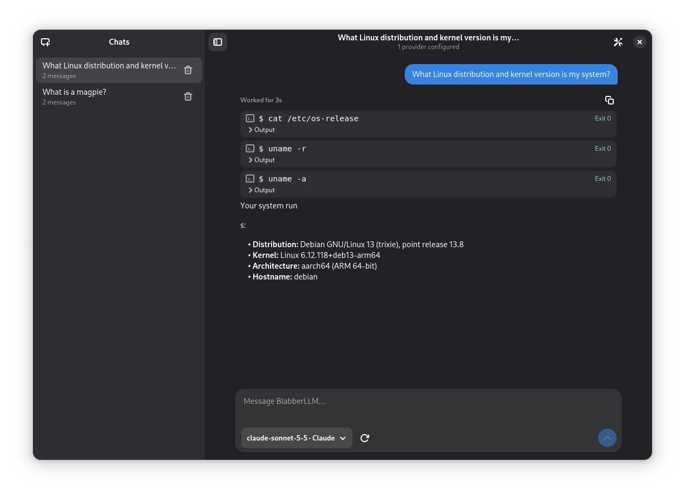

# BlabberLLM

A lightweight, native GTK4 & Libadwaita LLM chat client for GNOME, written in Rust. Designed to look and feel at home on Debian 13 and GNOME desktops while working with both cloud LLM providers and local open-weight models through Ollama.

## Download & Install

[](https://github.com/jankammerath/BlabberLLM/releases/latest/download/blabber-llm-amd64.deb)
[](https://github.com/jankammerath/BlabberLLM/releases/latest/download/blabber-llm-arm64.deb)
[](https://github.com/jankammerath/BlabberLLM/releases/latest/download/blabber-llm-x86_64.rpm)
[](https://github.com/jankammerath/BlabberLLM/releases/latest/download/blabber-llm-aarch64.rpm)

Browse all versions on the [GitHub Releases](https://github.com/jankammerath/BlabberLLM/releases) page.

### Debian / Ubuntu (`.deb`)

```bash
# x86_64 (amd64)
curl -LO https://github.com/jankammerath/BlabberLLM/releases/latest/download/blabber-llm-amd64.deb
sudo apt install ./blabber-llm-amd64.deb

# ARM64 (arm64)
curl -LO https://github.com/jankammerath/BlabberLLM/releases/latest/download/blabber-llm-arm64.deb
sudo apt install ./blabber-llm-arm64.deb
```

### Fedora / RHEL / openSUSE (`.rpm`)

```bash
# x86_64
curl -LO https://github.com/jankammerath/BlabberLLM/releases/latest/download/blabber-llm-x86_64.rpm
sudo dnf install ./blabber-llm-x86_64.rpm

# ARM64 (aarch64)
curl -LO https://github.com/jankammerath/BlabberLLM/releases/latest/download/blabber-llm-aarch64.rpm
sudo dnf install ./blabber-llm-aarch64.rpm
```

## Screenshots




## Features

- **Native GNOME / Adwaita UI**: Built with GTK4 and Libadwaita (`OverlaySplitView`, `PreferencesDialog`, `AlertDialog`, responsive breakpoints).
- **Multi-Provider & Multi-Account Support**: Configure endpoints and API keys for **Claude**, **Gemini**, **Grok**, **OpenAI**, **OpenRouter**, and **Ollama** — including multiple named accounts per provider (e.g., personal and work accounts).
- **Live Model Discovery & Memory**: Automatically fetches available models from configured providers into a searchable model selector inside the prompt composer. Configure a default provider/model in Settings for new chats, while each chat remembers its own last-used provider and model.
- **Streaming Markdown Output**: Real-time token streaming with cancellation (`Stop`), full-response text selection, one-click copy, headings, lists, native GTK4 tables, blockquotes, inline formatting, code blocks, and elapsed execution time (`Worked for …`).
- **Optional Shell Tool with Granular Permissions**:
  - Enable or disable local bash command execution in Settings.
  - Configurable approval policy: **Always ask**, **Only ask when dangerous**, or **Never ask**.
  - Optional **Allow Elevated Commands (`sudo`)** toggle that authorizes administrator actions securely through GNOME's native PolicyKit (`pkexec`) authentication prompt.
  - Executed commands and their expandable outputs are persisted in chat history across restarts and replayed into conversation context for follow-up turns.
- **Collapsible Chat History Sidebar**: Switch between or delete previous conversations, with automatic responsive collapsing on narrow windows.

## Building from Source

### Dependencies (Debian 13 / GNOME)

```bash
sudo apt install build-essential pkg-config libgtk-4-dev libadwaita-1-dev
```

You also need Rust **1.85+** (via [rustup](https://rustup.rs) or your distribution packages).

### Build & Launch

```bash
cargo run --release
```

Run the test suite:

```bash
cargo test
```

### Updating the Version & Publishing a Release

```bash
./scripts/bump-version.sh 0.2.0
git add Cargo.toml Cargo.lock
git commit -m "Release v0.2.0"
git tag v0.2.0
git push origin master --tags
```

Pushing a `v*` tag triggers the GitHub Actions pipeline (`.github/workflows/release.yml`), which runs tests, builds `.deb` and `.rpm` packages for both `x86_64` and `arm64`, and publishes a GitHub Release with all packages attached.

## Keyboard Shortcuts

| Shortcut | Action |
| --- | --- |
| `Enter` | Send message |
| `Shift+Enter` | Insert newline |
| `Ctrl+N` | Start a new chat |
| `Ctrl+,` | Open Settings |
| `F9` | Toggle chat history sidebar |
| `Ctrl+Q` | Quit |

## Configuration & Data Storage

BlabberLLM follows the XDG Base Directory specification and uses `GLib::KeyFile` for simple, inspectable local files:

- **Settings & API keys**: `$XDG_CONFIG_HOME/blabber-llm/settings.conf` (default `~/.config/blabber-llm/settings.conf`, saved with `0600` permissions on Unix).
- **Chat history**: `$XDG_DATA_HOME/blabber-llm/chats/` (default `~/.local/share/blabber-llm/chats/`).

## Architecture

- `src/main.rs` — Application bootstrap, CSS loading, and keyboard accelerators.
- `src/settings.rs` — Provider accounts, default model, and shell/sudo tool configuration persistence.
- `src/chats.rs` — Conversation, message, duration, and tool-call history persistence.
- `src/llm.rs` — Streaming HTTP client (`ureq` with `rustls`) and multi-turn tool-use loop for Claude, Gemini, Grok, OpenAI, OpenRouter, and Ollama.
- `src/tools.rs` — Shell command execution (`bash` / `pkexec`) and dangerous-command classifier.
- `src/ui/` — GTK4/Libadwaita UI modules (`window.rs`, `sidebar.rs`, `settings_dialog.rs`, `message.rs`, `markdown.rs`).
- `packaging/` & `scripts/` — Desktop entry, version bump script, and DEB/RPM packaging script.
